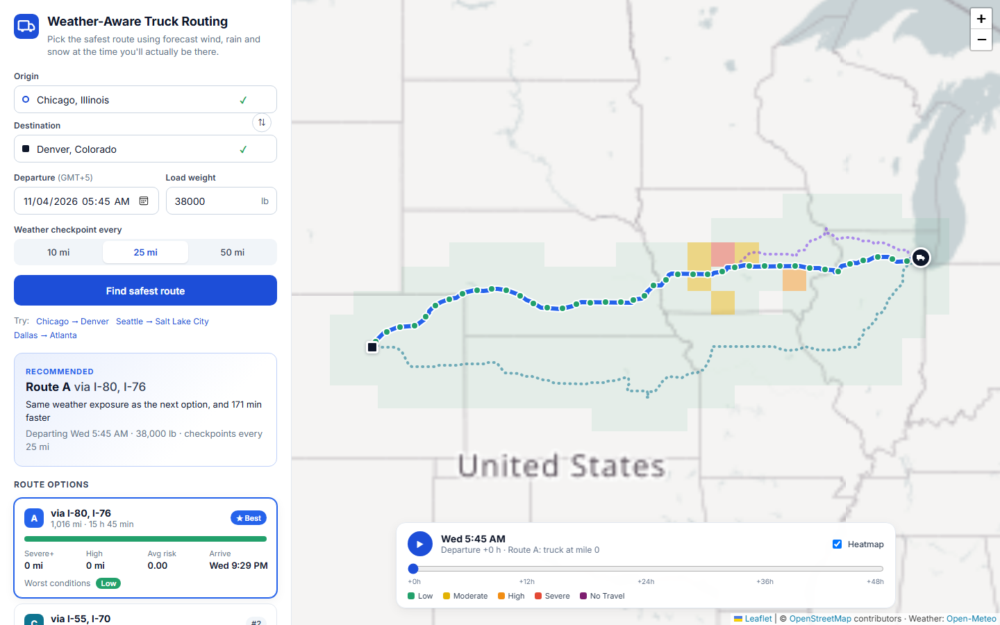
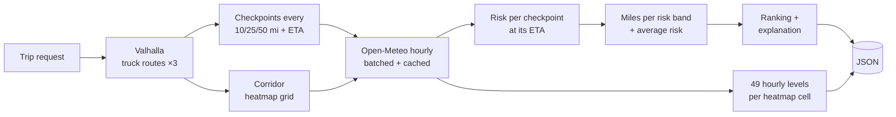

<div align="center">

# 🚚 Weather-Aware Truck Routing

**Pick the safest truck route using forecast wind, rain and snow at the time the truck actually gets there.**

[](https://github.com/burhanshafique01/weather-aware-truck-routing/actions/workflows/ci.yml)


[](LICENSE)

[**Deploy your own**](https://render.com/deploy?repo=https://github.com/burhanshafique01/weather-aware-truck-routing) · [Loom script](docs/LOOM_SCRIPT.md)



</div>

---

## Contents

- [What it does](#what-it-does)
- [How it works](#how-it-works)
- [Risk rules and interpretation](#risk-rules-and-interpretation)
- [Route recommendation](#route-recommendation)
- [Architecture](#architecture)
- [Run it locally](#run-it-locally)
- [Testing](#testing)
- [Deployment](#deployment)
- [API](#api)
- [Configuration](#configuration)
- [Design decisions and trade-offs](#design-decisions-and-trade-offs)
- [Limitations and next steps](#limitations-and-next-steps)

## What it does

A driver or dispatcher enters:

- **Origin and destination**, with type-ahead search (or free text, geocoded on the server)
- **Departure date and time**
- **Load weight** (lb)

The app then:

| Requirement | How it's met |
| --- | --- |
| Generate **3 route options** | Valhalla's **truck** profile with gross weight, plus distinct detour alternatives when the router returns fewer than three |
| Sample weather every **10 / 25 / 50 miles** at the **truck's ETA** | Checkpoints are placed along each route and timed from per-maneuver drive times. Hourly forecasts are interpolated to the exact ETA |
| Calculate risk with the **risk and load rules** | `risk.py` transcribes the table exactly; every boundary is unit-tested |
| **Recommend** the best route | Ranked by No Travel, then Severe, then High miles, then average risk, then travel time, with a one-line explanation |
| Show routes, checkpoints, risk, ETAs and summaries **on a map** | Leaflet map, route cards with risk-mile bars, checkpoint table and popups |
| **Heatmap** with a **0–48 h slider** | A corridor grid with 49 hourly risk levels per cell, scrubbed or played back with a moving truck marker |

Extras: shareable trip links, keyboard-accessible autocomplete, responsive layout, and gzip-compressed API responses.

## How it works



1. **Routes.** `valhalla.py` asks for the trip with `costing: truck` and the gross vehicle weight (load + 35,000 lb tare), plus up to two native alternates. If that yields fewer than three distinct routes, it requests detours *through* points offset to either side of the corridor midpoint. It keeps a detour only if it shares less than 85% of its miles with every existing route and is at most 60% slower than the fastest.
2. **Checkpoints and ETAs.** Each route is sampled every *N* miles, plus the destination. Valhalla reports time per maneuver; that time is spread over the maneuver's shape points by distance, so any point on the route has an ETA.
3. **Weather.** All checkpoint and heatmap coordinates are deduplicated (~0.7 mi precision), cached for 30 minutes, and fetched from Open-Meteo 50 at a time in parallel. Values are linearly interpolated between forecast hours, so a checkpoint reached at 14:40 gets 14:40 weather.
4. **Risk.** Each checkpoint is classified by wind (load-adjusted), rain and snow. The checkpoint's level is the worst of the three, with a human-readable reason.
5. **Metrics.** Each checkpoint covers the road from the midpoint with its previous neighbour to the midpoint with its next, so miles per band always add up to the route length.
6. **Heatmap.** A regular lat/lon grid around all routes. Cell size scales with trip length and is capped at 220 cells. Each cell has 49 hourly levels (departure +0 … +48 h).

## Risk rules and interpretation

| Condition | Low | Moderate | High | Severe | No Travel |
| --- | --- | --- | --- | --- | --- |
| Wind | < 25 mph | 25 – < 35 | 35 – < 45 | 45 – < 55 | **≥ 55 mph** |
| Rain | < 0.10 in/hr | 0.10 – < 0.25 | 0.25 – < 0.50 | 0.50 – 1.00 | **> 1.00** |
| Snow | < 0.5 in/hr | 0.5 – < 1.0 | 1.0 – < 2.0 | 2.0 – 3.0 | **> 3.0** |

Load rules (applied to wind):

- ≥ 55 mph → **No Travel** for any load
- 45–54 mph and load **> 30,000 lb** → **No Travel**
- 35–44 mph and load **> 40,000 lb** → **Severe**

Interpretation choices, each pinned by a test in [`test_risk.py`](backend/routing/tests/test_risk.py):

- **Shared boundaries go to the higher band.** The spec lists 0.25 in/hr in both Moderate and High, so every band is made lower-bound inclusive. This is the safer reading.
- **Top bands use the spec's own operators.** Wind uses "≥ 55", while rain and snow use "> 1.00" and "> 3.0". So exactly 1.00 in/hr of rain is Severe, not No Travel.
- **Load thresholds are strict** ("> 30,000 lb"): exactly 30,000 lb in 50 mph wind stays Severe.
- **Wind is the 10 m sustained wind** from Open-Meteo. Gusts are shown in the UI for context but don't drive the classification.
- **Rain is rain plus convective showers.** Snow is Open-Meteo snowfall in in/hr.

## Route recommendation

Routes are compared in the spec's order ([`recommend.py`](backend/routing/services/recommend.py)):

0. **Fewest No Travel miles.** The spec doesn't list this, but No Travel is worse than Severe. A route the truck can't finish shouldn't win just because it has fewer *Severe* miles.
1. **Fewest Severe miles**
2. **Fewest High miles**
3. **Lowest average risk**, distance-weighted on the 0–4 scale, with a **0.05 tolerance**
4. **Shortest travel time**

Miles are compared at 0.1-mile precision, so geometry noise never decides. The tolerance on average risk matters in practice. Two routes with the same 25 Moderate miles have averages of 0.025 and 0.023 only because one is longer, and without the tolerance that longer route would win despite being 76 minutes slower. Within the tolerance, the routes count as equally risky and travel time decides. That is how the app "balances weather risk and travel time" without inventing weights the spec doesn't give.

The winning card states the deciding criterion, for example *"Fewest Severe miles (0.0 mi vs 37.5 mi on the next option)"*.

## Architecture

```
weather-aware-truck-routing/
├── backend/                      Django 5 + DRF (stateless, no database)
│   ├── config/                   settings, urls (API + SPA fallback), wsgi
│   └── routing/
│       ├── services/
│       │   ├── planner.py        pipeline orchestration → response payload
│       │   ├── valhalla.py       truck routing, detours, long-trip stitching
│       │   ├── weather.py        Open-Meteo batching, caching, interpolation
│       │   ├── risk.py           thresholds + load rules (pure functions)
│       │   ├── recommend.py      metrics, ranking, explanation (pure)
│       │   ├── heatmap.py        corridor grid
│       │   ├── geocoding.py      Photon place search
│       │   ├── geo.py            haversine, polyline decoding, sampling
│       │   └── http.py           pooled session with retries/backoff
│       ├── serializers.py        request validation
│       ├── views.py              /api/plan, /api/geocode, /api/health
│       └── tests/                44 tests: rules, ranking, geometry, planner, API
├── frontend/                     React 18 + TypeScript + Vite + Leaflet
│   └── src/
│       ├── components/           TripForm, PlaceInput, RouteCard, CheckpointTable,
│       │                         MapView, HeatmapLayer, TimeSlider, RiskBar…
│       ├── api.ts · types.ts     typed API client and response contracts
│       ├── geo.ts · share.ts     truck position interpolation, share links
│       └── risk.ts · format.ts   palette and formatting
├── Dockerfile                    multi-stage: build React → serve from Django
├── render.yaml                   one-click Render blueprint
└── .github/workflows/ci.yml      lint, tests, typecheck, build, docker smoke test
```

**Third-party services** (all free and keyless by default):

| Purpose | Service |
| --- | --- |
| Truck routing | [Valhalla](https://valhalla.github.io/valhalla/) (public FOSSGIS server, OpenStreetMap data) |
| Weather | [Open-Meteo](https://open-meteo.com/) hourly forecast |
| Geocoding | [Photon](https://photon.komoot.io/) (OpenStreetMap) |
| Basemap | OpenStreetMap tiles |

## Run it locally

Prerequisites: **Python 3.11+** and **Node 18+**.

```bash
# 1. Backend
cd backend
python -m venv .venv
source .venv/bin/activate          # Windows: .venv\Scripts\activate
pip install -r requirements.txt
python manage.py runserver         # http://127.0.0.1:8000

# 2. Frontend (second terminal)
cd frontend
npm install
npm run dev                        # http://localhost:5173 (proxies /api to :8000)
```

No API keys are needed. To run the production build the way it's deployed:

```bash
docker build -t truck-routing .
docker run -p 8000:8000 -e DJANGO_ALLOWED_HOSTS=localhost truck-routing
# open http://localhost:8000
```

## Testing

```bash
cd backend  && python manage.py test routing      # 44 tests
cd frontend && npm test && npm run typecheck        # Vitest + tsc
```

The backend tests cover:

- **Every threshold boundary** for wind, rain and snow, including the shared 0.25 in/hr boundary
- **Load rules**, including the exact 30,000 / 40,000 lb boundaries
- **Ranking order**: Severe over speed, then High, then average-risk tolerance, then time, and No Travel ranked worst
- **Geometry**: polyline decoding, sampling, coverage summing to route length, offsets
- **The full planner** with stubbed providers. A storm on the fast route flips the recommendation, a heavy load turns Severe into No Travel, ETAs are linear at constant speed, and the heatmap has 49 hourly levels per cell.
- **API validation and error handling**

CI runs all of the above, plus `ruff`, a production build, and a Docker build with a smoke test.

## Deployment

The Dockerfile builds the React app and serves it from Django with WhiteNoise: **one service, one URL, no CORS**.

**Render (free tier):** create a *Blueprint* from this repository; `render.yaml` provisions everything and generates the secret key. Any Docker host also works (Railway, Fly.io, Cloud Run): set `DJANGO_ALLOWED_HOSTS` to your domain.

## API

### `POST /api/plan/`

```json
{
  "origin":      { "label": "Chicago, Illinois", "lat": 41.8781, "lon": -87.6298 },
  "destination": { "label": "Denver, Colorado" },
  "departure":   "2026-11-04T14:00:00Z",
  "load_lb":     38000,
  "interval_mi": 25
}
```

`lat`/`lon` are optional; without them, `label` is geocoded. `interval_mi` is one of `10`, `25`, `50`. Departure must be from now up to 7 days ahead, so the forecast covers the trip.

Response (abridged):

```jsonc
{
  "recommended_route_id": "A",
  "routes": [{
    "id": "A", "via": ["I-80", "I-76"], "distance_mi": 1016.4, "duration_s": 56672,
    "arrival": "2026-11-05T05:44:32Z", "rank": 1, "recommended": true,
    "reason": "Same weather exposure as the next option, and 76 min faster",
    "metrics": { "miles_by_level": { "low": 991.4, "moderate": 25.0, "high": 0, "severe": 0, "no_travel": 0 },
                 "average_risk": 0.025, "max_level": 1 },
    "path": [[41.8781, -87.6298, 0], "…[lat, lon, seconds since departure]"],
    "checkpoints": [{
      "mile": 75.1, "eta": "2026-11-04T15:16:03Z", "coverage_mi": 25.0,
      "weather": { "wind_mph": 18.4, "gust_mph": 28.7, "rain_in_hr": 0.01, "snow_in_hr": 0 },
      "risk": { "level": 0, "label": "Low", "components": { "wind": 0, "rain": 0, "snow": 0 }, "reasons": [] }
    }]
  }],
  "heatmap": { "start": "…", "hours": 48, "dlat": 0.57, "dlon": 0.75,
               "cells": [{ "lat": 41.3, "lon": -96.2, "levels": "0001122…", "wind": [], "rain": [], "snow": [] }] }
}
```

Errors return `{"detail": "…"}` with `400` (validation), `422` (no route or place found) or `502`/`503` (provider failure).

### `GET /api/geocode/?q=denver` · `GET /api/health/`

## Configuration

All optional; see [`.env.example`](.env.example).

| Variable | Default | Purpose |
| --- | --- | --- |
| `DJANGO_SECRET_KEY` | dev key | Required in production |
| `DJANGO_DEBUG` | `true` | `false` in production |
| `DJANGO_ALLOWED_HOSTS` | `localhost,127.0.0.1,.onrender.com` | Comma-separated |
| `VALHALLA_URL` | public FOSSGIS server | Point at a self-hosted Valhalla |
| `VALHALLA_MAX_LEG_KM` | `1500` | Per-request span limit (raise for self-hosted) |
| `OPEN_METEO_API_KEY` | – | Use Open-Meteo's commercial endpoint |
| `WEATHER_CACHE_SECONDS` | `1800` | Forecast cache lifetime |
| `API_RATE_LIMIT` | `30/min` | Per-IP throttle on `/api/plan/` |
| `VITE_TILE_URL` | OSM tiles | Basemap tile template (build time) |

## Design decisions and trade-offs

- **ETA-accurate weather.** The forecast is sampled at the moment the truck reaches each checkpoint and interpolated between hours. A storm at the halfway point right now doesn't matter if the truck gets there after it clears; the Chicago → Denver screenshot shows exactly that.
- **Truck-aware routing.** Valhalla's truck costing respects weight and truck restrictions. A car router would happily send a 73,000 lb rig down roads it can't use.
- **Guaranteed three distinct options.** Native alternates first, then filtered detours. The overlap check uses a spatial hash, so it stays fast on 3,000-mile routes.
- **Long trips work on the public server.** Trips over its 1,500 km limit are split at great-circle waypoints, which can snap to a highway within 15 km, then stitched back together.
- **One weather fetch per plan.** Checkpoints for every route and the heatmap share a deduplicated, cached batch. A cross-country plan with ~200 locations takes about 4 HTTP calls.
- **Smooth heatmap.** Cells are created once per plan on their own canvas pane. Moving the slider only restyles them, with no React re-render or DOM churn. Playback uses `requestAnimationFrame` with fractional hours, so the truck moves smoothly.
- **Small payloads.** Paths are simplified to about 1,500 vertices per route, heatmap levels are encoded as one digit per hour, and responses are gzipped (~8× smaller).
- **Stateless backend.** No database: plans are computed on demand, and only provider responses are cached.
- **Pure domain core.** `risk.py` and `recommend.py` have no I/O, so the rules that carry 40% of the grade are trivially testable.

## Limitations and next steps

- The public Valhalla, Photon and Open-Meteo endpoints are fair-use services. For production, self-host Valhalla and use a commercial Open-Meteo key (both are already configurable).
- Forecast skill drops with lead time. Showing model uncertainty (for example, ensemble spread) would let the ranking prefer routes that are robustly safe.
- Hours of service, fuel stops and rest breaks aren't modelled; ETAs assume continuous driving at router speeds.
- Possible extras: re-checking the forecast while en route, alerts when a planned route's risk changes, and comparing departure times ("leave 3 hours later to avoid the storm").

## License

[MIT](LICENSE). Map data © OpenStreetMap contributors. Weather data by Open-Meteo.com (CC BY 4.0).
